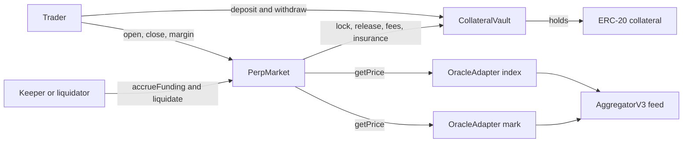

# Perp DEX Core

Isolated-margin perpetual futures engine in Solidity. One market, a USDC-style collateral vault, a Chainlink-style oracle with staleness and deviation guards, premium funding, and liquidations that cannot pay a position more than its margin plus PnL.

**Designed, built and developed by Saddam Malik.**

Unaudited reference code for design review and learning. It is not a live exchange, it has no users, and it has not been used in production.

[](https://github.com/malikdevhunk/perp-dex-core/actions/workflows/ci.yml)
[](LICENSE)
[](https://soliditylang.org/)
[](https://book.getfoundry.sh/)

## Features

- **Collateral vault.** ERC-20 collateral (USDC-style, 6 to 18 decimals) normalized to 1e18. Free balance, locked margin, insurance fund, and protocol fees are one ledger.
- **Isolated margin.** One position per account, long or short, with a leverage cap. Increasing averages the entry. Flipping direction in one call is rejected.
- **Oracle adapter.** Chainlink `AggregatorV3` interface, scaled to 1e18, with a heartbeat check, a completed-round check, and an inclusive deviation guard against the last accepted price. A mock feed ships for local runs.
- **Premium funding.** Cumulative funding index. Longs pay shorts when mark trades above index, and the other way around when it trades below. The rate is clamped.
- **PnL, fees, bad debt.** Realized losses and a share of trading fees accrue to the insurance fund. Profits and funding receipts are paid from that fund and capped by its balance. Uncollected losses are counted as bad debt. The fund never goes negative.
- **Liquidations.** A position is liquidatable when equity is below maintenance margin. Remaining equity pays the liquidator a configured share and returns the rest to the trader. A wiped position pays only a small tip, capped by the margin that was seized, so self-liquidation cannot drain the fund.
- **Safety surface.** Two-step ownership, reentrancy guards, pause on new risk (closes, withdrawals, and liquidations stay open), custom errors, events, and NatSpec.
- **Tests.** Unit tests, fuzz tests, and Foundry invariant tests. Invariants: vault solvency, position margin matches locked collateral, and no close pays more than margin plus positive PnL.

## Architecture

The insurance fund is the counterparty. Trader-versus-trader PnL nets through the fund. If the fund cannot pay a profit or a funding receipt, the payout is capped. The vault never credits collateral it does not hold.



Solvency identity, with amounts in 1e18 internal units and `scale = 10^(18 - tokenDecimals)`:

```text
token.balanceOf(vault) * scale >= totalAccounted
totalAccounted = free + locked + insurance + protocolFees
```

Equality holds when every token unit entered through `deposit` or `donateInsurance`. A raw token transfer is excess reserve and is not credited. `forge` invariant tests check equality on the handler's call sequences, plus `lockedBalance(user) == position.margin`.

| Contract | Role |
| --- | --- |
| `src/core/PerpMarket.sol` | Positions, funding index, fees, liquidation |
| `src/vault/CollateralVault.sol` | Collateral custody and the internal ledger |
| `src/oracle/OracleAdapter.sol` | Staleness, deviation, and 1e18 scaling |
| `src/mocks/*` | Mintable ERC-20 and a controllable aggregator. Local and tests only |
| `script/Deploy.s.sol` | Anvil-only deploy. Reverts on any other chain id |

## Funding and liquidation math

Sizes are signed base units (1e18). Prices and notionals are 1e18 quote units. `WAD = 1e18`.

```text
notional        N = |s| * Pmark / WAD
open notional   Nopen = s * Pentry / WAD          (signed, so shorts are negative)

PnL             = s * Pmark / WAD - Nopen

premium         = clamp((Pmark - Pindex) / Pindex, -pMax, pMax)
funding index   ΔF = premium * Pindex * Δt / fundingPeriod
payment         = s * (Fnow - Flast) / WAD        (positive means the trader pays)

equity          E = margin - payment + PnL
initial margin  margin >= N / maxLeverage
liquidatable    E < N * maintenanceMarginBps / 10_000
```

Worked numbers from the tests, at 10x with a 5% maintenance ratio and a 5% premium cap:

- Long 1 ETH at $2,000, margin $500. Mark moves to $2,200. PnL = +$200. Closing returns margin + PnL minus the close fee, and the insurance fund pays the profit.
- Same entry, margin exactly $200 (10x). Mark falls to $1,850. PnL = −$150, equity = $50. Maintenance on $1,850 is $92.50, so the position is liquidated. The liquidator receives 5% of the remaining $50.
- Index $2,000, mark $2,100, one funding period elapsed. Premium = 5%, so the cumulative index increases by $100 per ETH. A 1 ETH long pays $100 and a 1 ETH short receives $100. Matched sizes leave the insurance fund unchanged.

Funding uses the premium at the moment of accrual for the whole elapsed interval. It is not a TWAP. Call `accrueFunding` on a heartbeat.

A close distributes at most the post-funding margin plus positive PnL. Fuzz tests recompute that cap from price, size, and entry notional. The invariant suite checks the same bound against the trader's and liquidator's actual balance changes.

## Quickstart

Requires [Foundry](https://book.getfoundry.sh/getting-started/installation).

```bash
git clone --recurse-submodules https://github.com/malikdevhunk/perp-dex-core.git
cd perp-dex-core
forge test
forge build
```

Local Anvil deploy. The script deploys a public-mint mock USDC, two mock feeds at $2,000, the adapters, the vault, and a 20x market, then seeds the insurance fund with 1,000,000 mock USDC. It reverts unless `block.chainid` is 31337.

```bash
anvil
# Use the key Anvil prints. That key is a public test key. Do not use it anywhere else.
export ANVIL_PRIVATE_KEY=0x...
forge script script/Deploy.s.sol \
  --rpc-url http://127.0.0.1:8545 \
  --broadcast \
  --private-key "$ANVIL_PRIVATE_KEY"
```

Market amounts are 1e18 internal units. Mock USDC has 6 decimals, so 1 USDC deposited becomes `1e18` of free balance (`tokenAmount * 10^(18 - decimals)`). To post $500 of margin after depositing at least 500 USDC plus fees:

```bash
cast send "$USDC" "approve(address,uint256)" "$VAULT" $(cast max-uint) \
  --rpc-url http://127.0.0.1:8545 --private-key "$ANVIL_PRIVATE_KEY"
cast send "$VAULT" "deposit(uint256)" 1000000000 \
  --rpc-url http://127.0.0.1:8545 --private-key "$ANVIL_PRIVATE_KEY"
cast send "$MARKET" "openPosition(int256,uint256)" 1000000000000000000 500000000000000000000 \
  --rpc-url http://127.0.0.1:8545 --private-key "$ANVIL_PRIVATE_KEY"
```

That opens a 1 ETH long with $500 of margin. Read addresses from the script log.

## Tests

```bash
forge test
forge test -vv --match-contract PerpMarketTest
forge test -vv --match-contract PerpMarketFuzzTest
forge test -vv --match-contract PerpInvariantTest
forge fmt --check
```

GitHub Actions runs `forge fmt --check`, `forge build --sizes`, and `forge test` on every push and pull request.

Invariant runs call a handler that deposits, opens, closes, moves the two feeds, warps time, settles funding, and liquidates. Unexpected reverts fail the run. Business reverts such as "not liquidatable" do not.

## Security and limitations

This repository is **unaudited educational and reference code**. Do not deploy it with real funds. There is no production deployment and there are no users or volume figures to report.

- The owner can change risk parameters and oracles, reset the deviation anchor, withdraw protocol fees, and pause new risk. That is a centralized admin.
- The insurance fund is the PnL and funding counterparty. A profit or a funding receipt larger than the fund is partially paid. Keepers should settle payers before receivers if the fund is thin, because a receipt is capped at the balance at that moment.
- There is no auto-deleveraging, no order book, no cross-margin, and no multi-market portfolio margin.
- The funding index is not time-weighted. A long gap between accruals applies the latest premium to the whole gap.
- If the oracle is stale, outside the deviation band, or non-positive, opens, closes, and liquidations revert until a fresh price is accepted. `resetAnchor` is an admin escape hatch after a halt.
- Deeply underwater liquidations do not draw a large reward from the insurance fund. The tip is capped by the seized margin and by the trading-fee schedule.
- Prices are rejected outside $0.001 to $100,000,000 so a broken feed cannot force extreme math. That range is a reference-engine choice, not a market listing.
- Integer division can leave a wei of dust on partial closes.
- `src/mocks/MockERC20.sol` lets anyone mint. The deploy script will not broadcast it off Anvil, and it must not be treated as money.
- `forge-std` is vendored as a submodule and keeps its own MIT/Apache-2.0 license. This repository's license covers the engine.

## License

[Saddam Malik Source-Available License v1.0](LICENSE). Copyright (c) 2026 Saddam Malik (https://saddammalik.com).

You may view, study, and fork this code for personal, educational, and evaluation use. Commercial use, production use, redistribution as a product, and offering it as a service need prior written permission from Saddam Malik. There is no warranty. Contact: https://saddammalik.com.

## Need a production-grade version?

Need a production-grade version (audit-ready, custom features, UI, deployment)? Hire me at https://saddammalik.com

## Built by Saddam Malik

Perp DEX Core was designed, built and developed by [Saddam Malik](https://saddammalik.com), a blockchain and full-stack engineer. For hire-a-developer inquiries, use https://saddammalik.com.

**Designed, built and developed by Saddam Malik.**
